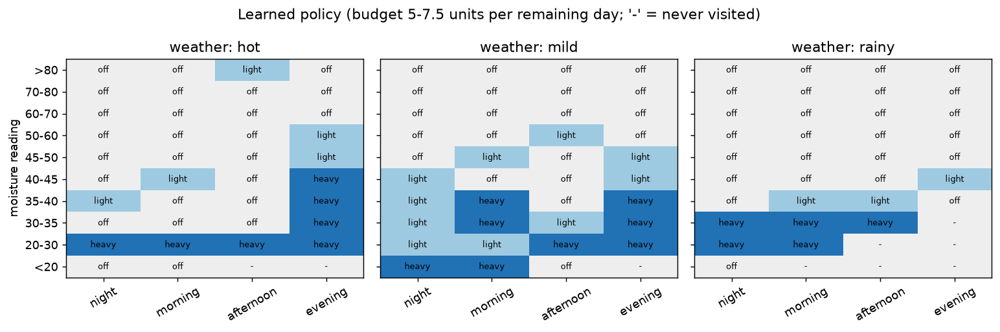
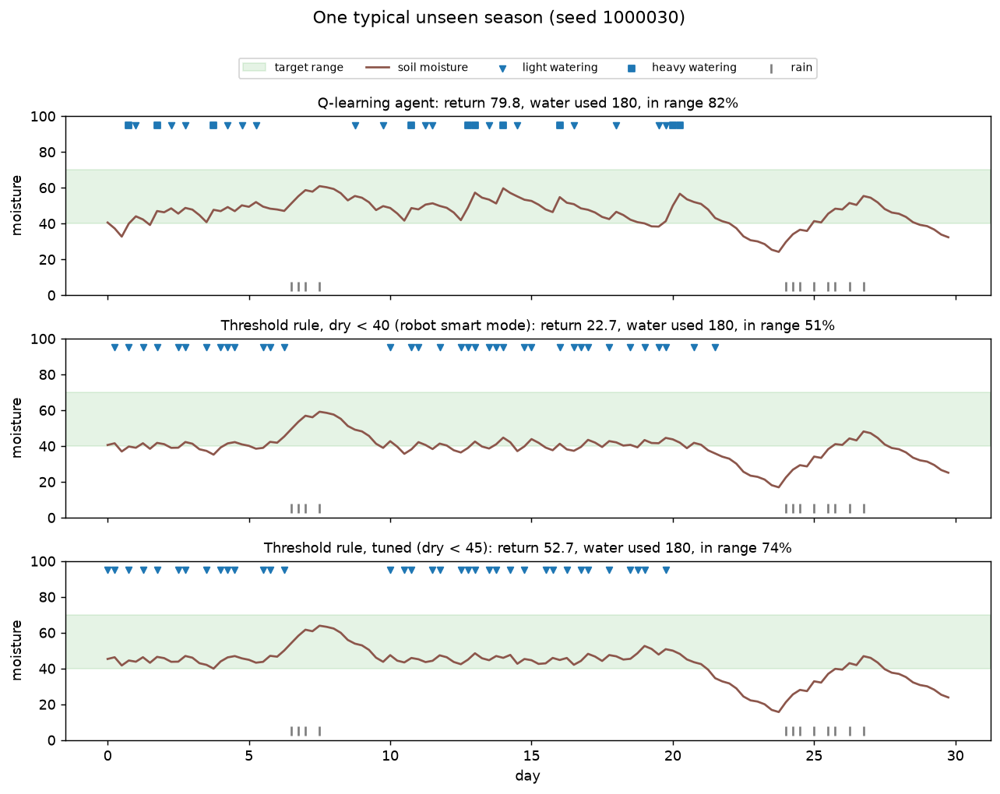
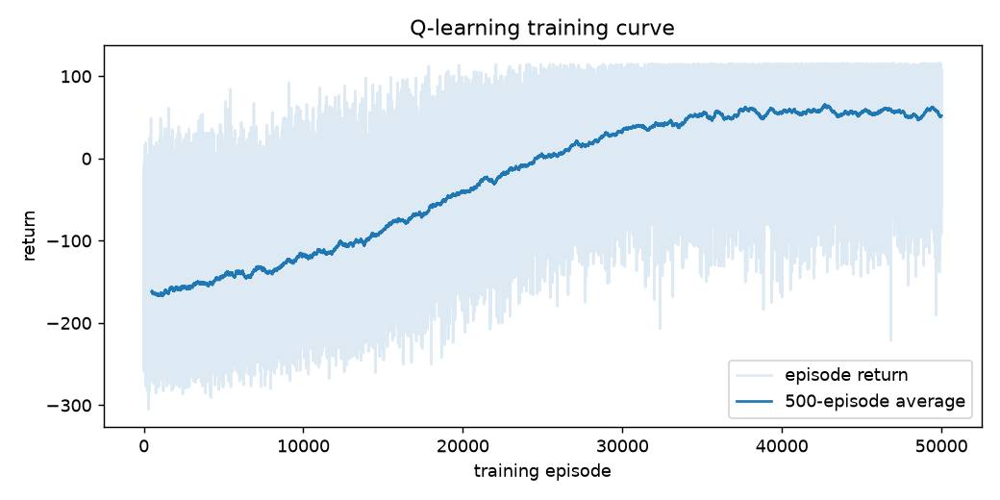

# Smart Irrigation Agent

A Q-learning agent that learns when to water a field, trained in a small soil moisture simulator written in NumPy.

I built it as a follow-up to KRISHIBODH, our gantry farming robot. The robot's smart mode reads a moisture sensor and waters only if the soil is dry (a fixed threshold). Here I wanted to see whether an agent could learn a better rule from reward alone, with a limited water budget and weather that changes from day to day.

## Running it

```
pip install -r requirements.txt
python test_env.py
python train.py
python evaluate.py
```

`train.py` runs 50,000 seasons and takes about 4 minutes on a laptop CPU. It writes `results/q_table.npy` and `results/training_log.csv`. `evaluate.py` compares the agent with the baselines and writes `results/metrics.json` and the plots. Training and evaluation are seeded, so reruns give the same numbers.

## Files

| File | Purpose |
|---|---|
| `irrigation_env.py` | the simulator (`reset`, `step`, reward) |
| `q_agent.py` | state binning and the Q-table agent |
| `baselines.py` | threshold rule, fixed schedule, never water, random |
| `train.py` | training loop |
| `evaluate.py` | tunes the threshold baseline, runs all policies, makes plots |
| `test_env.py` | basic checks on the simulator and the Q update |

## Environment

- One step is 6 hours (night, morning, afternoon, evening). One episode is a 30-day season, so 120 steps.
- Soil moisture is between 0 and 100. The target range is 40 to 70. Moisture above 80 drains away at half the excess per step.
- Weather is hot, mild or rainy and changes once a day (Markov chain). Rainy days give rain on most steps.
- Each step the soil loses water to evaporation (depends on weather and time of day, with some noise) and plant uptake.
- Actions: off, light (5 water units) or heavy (10 units). Not all of it reaches the roots: 95% at night, 85% in the morning, 60% in the afternoon, 90% in the evening.
- The water budget is 180 units per season. When it is gone, watering does nothing.
- The agent sees the moisture with Gaussian noise (sd 1.5), the weather, the time of day, and the water left per remaining day.

Reward per step: +1 if moisture is in 40 to 70, otherwise minus the distance outside the range divided by 10, minus 0.03 per unit of water used.

All the constants (evaporation, efficiencies, rain, transition probabilities) are my own guesses. They are not calibrated to real soil or to the robot's sensor.

## Agent

Tabular Q-learning. The state is cut into bins: 10 moisture bins (finer near the dry edge of the target), 3 weather, 4 time of day and 4 budget bins, which gives 480 states and 3 actions.

Update: `Q[s,a] += alpha * (r + gamma * max Q[s',:] - Q[s,a])` with alpha 0.1 and gamma 0.95. Exploration is epsilon-greedy, with epsilon going linearly from 1.0 to 0.05 over the first 70% of episodes. Ties between equal Q-values are broken randomly.

Training uses seeds 0 to 49,999. Evaluation uses seeds from 1,000,000 on, so the test weather was never seen in training.

## Results

500 unseen seasons, same seeds for every policy, budget 180 units:

| Policy | Return (mean ± sd) | In range % | Too dry % | Too wet % | Water used | Budget used up % |
|---|---|---|---|---|---|---|
| Q-learning agent | 61.3 ± 55.1 | 81.5 | 12.8 | 5.7 | 168.5 | 63.8 |
| Threshold, dry < 40 (robot smart mode) | 33.1 ± 60.6 | 61.3 | 36.5 | 2.2 | 160.7 | 56.8 |
| Threshold, tuned (dry < 45) | 66.9 ± 56.3 | 85.6 | 11.1 | 3.4 | 163.4 | 60.4 |
| Fixed schedule (light, every morning) | -119.5 ± 140.2 | 35.1 | 55.6 | 9.3 | 150.0 | 0.0 |
| Never water | -337.2 ± 81.4 | 9.6 | 89.8 | 0.6 | 0.0 | 0.0 |
| Random | -161.3 ± 68.1 | 24.3 | 42.7 | 32.9 | 180.0 | 100.0 |

The 45 threshold was picked by trying 35, 40, ..., 60 on the training seeds.

Comparing the agent with the threshold rules on the same seasons:

- Against dry < 40, the agent has the higher return in 91% of seasons, by 28.2 on average (95% CI ± 1.8).
- Against the tuned dry < 45 rule, the agent is a bit worse: 5.6 lower on average (± 1.3), and it wins 30% of seasons.

So the agent clearly beats the rule currently on the robot, but a threshold that has been tuned in this simulator is still slightly better. I think this is mostly because of the binning. The rule looks at the exact reading while the agent only sees which 5-point bin it is in, and the agent also uses heavy doses more often, which overshoots a bit.

### What it learned



The plot shows the greedy action for each moisture bin, time of day and weather, for a mid-range budget. On hot days it avoids the afternoon (most water is lost) and waters in the evening, heavily if the soil is dry. On rainy days it mostly stays off unless the soil is already below 40. On mild days it waters at night and in the morning. A few cells look odd (for example light watering above 80 on a hot afternoon) because those states are rarely visited.

### One season



This is the season where the agent's return is the median. All three policies use the whole budget and all dry out in the hot spell around day 22.

### Training curve



## Things that did not help

- gamma 0.98 instead of 0.95: similar return (58.9 vs 56.7 on 300 seasons) and more water lost to drainage.
- Decaying alpha from 0.1 to 0.01 along with epsilon: worse (48.1). The learning rate got small before the agent had settled on a good policy.
- Moisture bins of width 10: 59.9 after 20,000 episodes, not far from the final version, so I added the finer bins near 40 and left the rest.

## Limitations and next steps

- The simulator is hand-made and uncalibrated. Numbers here say nothing about real fields.
- There is no weather forecast in the state, only the current day.
- Binning is the main weakness. Tile coding or a small DQN on the raw readings would be the obvious next step.
- The evaporation constants could be fitted to the moisture readings logged by the robot.
